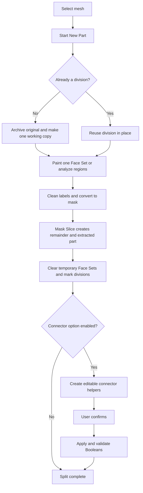

# Architecture

Blender Print Splitter is a Python Blender Extension for Blender 5.3.0+. It separates one marked region per interaction and keeps connector placement separate from connector Boolean application.

## Workflow model

## Object lifecycle

- An unmarked source is assigned a stable source ID and marked `ORIGINAL`. The object keeps its name, moves to **Print Splitter | Archived Originals**, and is hidden, unselectable, and hidden from render.
- One independent working object and mesh copy is created for the first interaction. Its role is `WORKING`.
- Extracted results are marked `DIVISION`, assigned part/parent metadata, and moved into **Print Splitter | Parts**.
- Later operations on `WORKING` or `DIVISION` meshes reset their marking data and reuse that object. They do not create another source copy.
- Connector controllers and cutter/pin meshes live in **Print Splitter | Connector Helpers** and reference their part targets through IDs.

Custom property keys and collection names are defined in `blender_print_splitter/core.py` and `connectors.py`.

## Face Set and mask data

- Face Sets use Blender's `.sculpt_face_set` integer face attribute. ID `1` is the background; the add-on uses ID `2` or greater for a paint target or generated regions.
- Manual painting writes a persistent target ID across strokes. Erasing returns faces of that target to the background ID.
- Automatic analysis calls Blender's native `sculpt.face_sets_init` with `NORMALS` or `LOOSE_PARTS`. The add-on shifts IDs to keep the background value reserved and stores a region-count summary for selectors.
- Region merging relabels faces and does not change vertices.
- Before extraction, cleanup filters small painted components and may bridge nearby painted components. The selected Face Set is mapped to the point-domain `.sculpt_mask` attribute.
- Blender's `sculpt.paint_mask_slice` creates the selected part and complementary remainder with filled interfaces. The add-on clears Face Sets and masks from both outputs.

## Connector lifecycle

Connector creation is controlled before marking or analysis:

- With connectors off, splitting produces no helper objects or unresolved connector state.
- With connectors on, the split creates a visible pin, socket cutter, and shared transform controller. Optional magnet cutters are created beside them.
- Property updates regenerate helper geometry; they do not run Booleans on the part meshes.
- Confirmation resolves target parts by internal part IDs, copies both mesh datablocks for rollback, applies the requested Boolean operations, checks closed topology and volume direction, and restores both meshes on failure.
- A connector pair remains pending until confirmed. Pending pairs block another split.

In manual mode, the extracted region receives the pin and the remainder receives the socket. In Mother/Part analysis mode, the Mother receives the pin and the extracted Part receives the socket.

## Module map

| Module | Responsibility |
| --- | --- |
| `__init__.py` | Extension metadata and module registration order. |
| `registration.py` | Safe class registration/unregistration for reload and partial-registration recovery. |
| `core.py` | Object roles, IDs, collections, working-copy creation, Face Set reset, and unit conversion. |
| `settings.py` | Scene-level UI properties and update callbacks. |
| `ui.py` | Print Splitter sidebar panel and connector controls. |
| `paint.py` | Manual single-ID paint/erase modal tool and viewport interaction. |
| `segmentation.py` | Native Face Set initialization, on-mesh region merge, and analysis-mode switching. |
| `split.py` | Label cleanup/smoothing, Face Set-to-mask conversion, Mask Slice extraction, and division metadata. |
| `connectors.py` | Helper mesh generation, preview updates, Boolean confirmation, quality checks, and rollback. |

## Main invariants

1. Never apply connector Booleans to the archived original.
2. Do not create additional full-mesh copies when splitting an existing division.
3. Keep connector preview editable and Boolean-free until confirmation.
4. Produce one extracted region per interaction.
5. Treat generated analysis Face Sets as temporary; clear them after a successful split.
6. Do not move vertices when smoothing Face Set labels.
